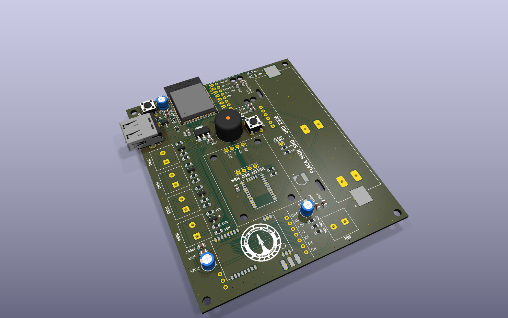
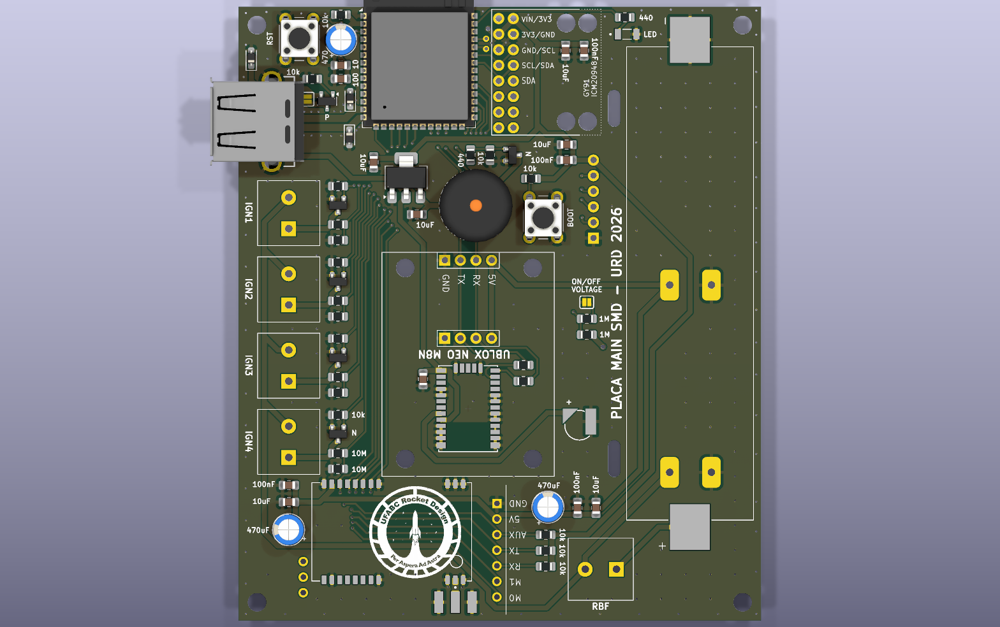
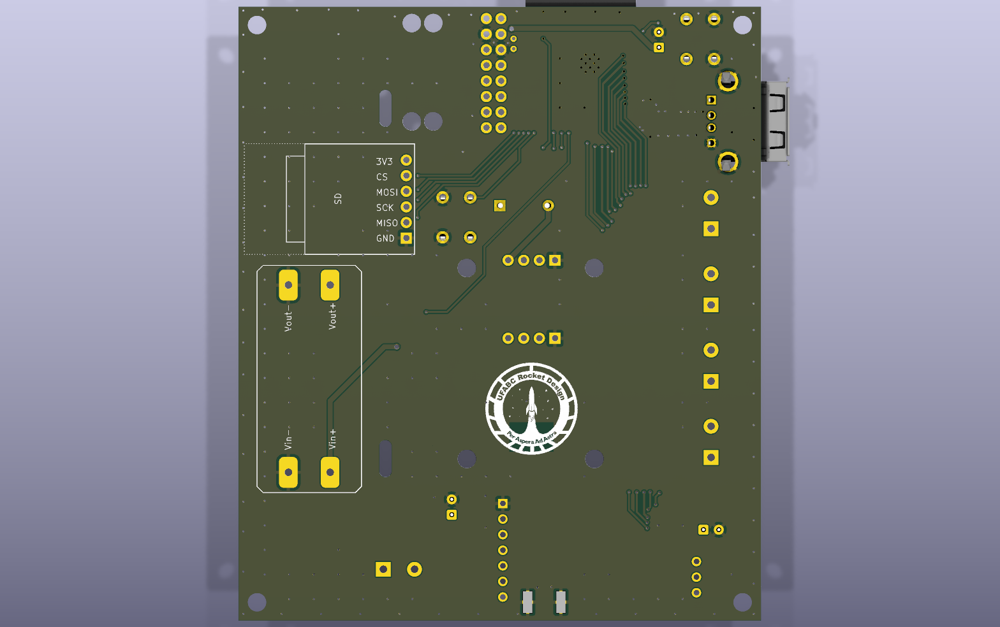

# PlacaMainSMD Simplificada

Mesma proposta da [PlacaMainSMD v1](https://github.com/jcardozo08/PlacaMainSMD_v1), mas com uma mistura de componentes **SMD e PTH** e com **módulos fáceis de encontrar** no mercado (GPS NEO-M8N, IMU GY-91, LoRa E32/E22) no lugar dos sensores soldados direto na placa. Assim ela fica mais barata, mais fácil de montar e de consertar em campo, e serve de alternativa robusta à v1.

## Destaques

- **ESP32-S3-WROOM-1**
- Conectores para GPS **u-blox NEO-M8N** e IMU **GY-91 / ICM-20948**
- Rádios LoRa **E22-900T22S** / **E32-915T20D** com conector SMA
- **4 canais de ignição** com MOSFETs SI2300, chave RBF, chave ON/OFF e buzzer
- Bateria de backup **ML414H** e porta USB-A
- **Gerbers** e arquivos de montagem **JLCPCB** incluídos
- Firmware: [FlightCode](https://github.com/jcardozo08/FlightCode) (`PLACA_MAIN_SMD`) / [FlightComputerRTOS](https://github.com/jcardozo08/FlightComputerRTOS)

| Topo | Base |
|:---:|:---:|
|  |  |

## Arquivos

- `PlacaMainSMD_Simplificada.kicad_sch`: esquemático ([ver em SVG](images/schematic.svg))
- `PlacaMainSMD_Simplificada.kicad_pcb`: layout da placa ([ver em SVG](images/layout.svg))
- `jlcpcb/`: Gerbers, furação, BOM e CPL para fabricação
- `PlacaMainSMD_Simplificada.step`: modelo 3D

**Ferramenta:** KiCad
